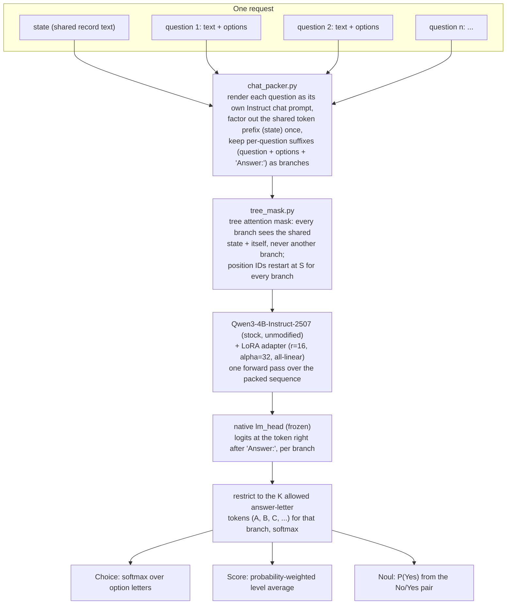

# jeb-scratch: Jev-Style Multi-Question Inference Reproduction

A reproduction of Jev-style "System One" inference: one shared **state** (free-form
text), many typed **questions** (Choice / Score / Noul), answered together via a
tree-masked attention pack so the shared state is only encoded once.

The design is a *reconstruction* from publicly described Jev behavior, not a claim
about the actual internals of the proprietary model.

## Architecture



Training distills `deepseek-flash` teacher probabilities into this same answer-letter
distribution via KL loss at the decision position only (`e2/train_lora.py`); the LoRA
adapter is the only thing trained, the backbone and `lm_head` stay frozen.

## Current system (E2)

Production backbone is `Qwen/Qwen3-4B-Instruct-2507` (stock `AutoModelForCausalLM`,
weights unmodified) plus a LoRA adapter (`r=16, alpha=32, target_modules="all-linear"`,
native `lm_head` frozen). There is no custom readout head: the model reads the answer
letter (A/B/C…) directly off the native LM head at the position right after `Answer:`.

What changes relative to the stock backbone:

- **Packing** (`e2/chat_packer.py`): multiple questions about the same state share one
  token-level prefix (the Instruct chat-template-rendered state), each question's suffix
  (question + options + `Answer:`) is appended as a separate branch.
- **Tree attention mask + per-branch position IDs** (`model/tree_mask.py`): every branch
  sees the shared state and its own tokens, never another branch's tokens; each branch's
  RoPE positions restart right after the state so branch order/length never changes
  another branch's answer.
- **Training objective** (`e2/train_lora.py`): KL distillation from a teacher
  (`deepseek-flash`) soft label distribution over the answer-letter tokens at the
  decision position only — not full-vocabulary next-token cross-entropy.

Selected checkpoint: `checkpoints/e2/lr-1e-4/epoch-3-quarter-3/` (LoRA adapter only,
~126MB). Final inference config: **single canonical-order forward** (no order-averaging;
see `results/logs/2026-09-28_latency_breakdown.md` for the accuracy/latency comparison
that motivated this).

## Mac inference (MLX)

On Apple Silicon, use `mac/jev_mlx.py` (`JevMLX`) instead of the PyTorch MPS path. It
merges the LoRA into the base weights once at load (fp32 accumulation, fp16 storage)
and runs the same packed tree-mask forward on MLX. `predict_request` has the same
contract as `e2.evaluate_lora.predict_request`. On an M2, order-averaged inference takes
about 0.87s per request, versus about 3.0s on PyTorch MPS, with matching predictions
(`results/logs/2026-09-30_mac_mlx_inference.md`). `python -m mac.bench {latency|eval}`
measures it on the teacher eval split. `e2/` stays PyTorch for training and CUDA
evaluation.

`python -m mac.serve [--port 8765]` keeps `JevMLX` resident behind a local HTTP API
(`GET /health`, `POST /predict` with `{state, branches:[{kind, instructions, options}]}` →
canonical-order `probabilities`) so tools such as omp hooks avoid per-call model load.

### Hacker News reading recommendations

From this repository, run **`./hn`**. It loads the local MLX model, fetches
recent linked HN stories using the public Algolia index, ranks their titles,
prints article and discussion links, and exits. No separate server or HN
login is needed. Searches cover LLM inference, attention, model evaluation,
local LLMs, and transformers; duplicate hits are removed. Adjust `--days`,
`--per-query`, and `--limit` to change the lookback, candidate pool, and
number of recommendations (e.g. `./hn --per-query 2 --limit 3`).

From any directory, use `/Users/senna/Documents/Repos/jeb-scratch/hn`.
The model loads afresh each run; scoring can take several minutes on a
memory-constrained Mac. Use `--per-query 1` for a smaller daily list.

Ranking is based **only on HN titles**, not the linked articles; search can miss
relevant posts, and the displayed model scores are **not calibrated
probabilities** or evidence of article quality. Read the source before
commenting.

## Repository layout

```text
e2/                 production training + evaluation code (Qwen3-4B + LoRA)
model/              packer.py, tree_mask.py — packing/masking shared with e2/
mac/                Apple Silicon inference on MLX (merged LoRA, fp16) + bench
data/e2/            production training/eval data (states, teacher branches, task types)
checkpoints/e2/     selected LoRA adapter
evaluation/         Gold V1 evaluation harness (evaluation/private/ is gitignored)
results/logs/       dated experiment reports (markdown)
results/artifacts/  generated json/jsonl outputs (predictions, bootstrap CIs, etc.)
internal-docs/      specs, ADRs, roadmap (gitignored, not published)
legacy/             archived Gate-era prototype (Qwen2.5-0.5B + self-built pointer/noul
                    readout head) — see legacy/README.md for its own write-up and results
```

## Rules

- **Never use Gold V1** (`evaluation/private/gold_v1_adjudicated*.jsonl`) for training,
  data/prompt/hyperparameter/checkpoint design, or iterative selection — it is a final
  test only. See `internal-docs/E2_PILOT_SPEC.md` §2 and the durable project memory for
  the full rule and its rationale.
- Candidate/checkpoint selection uses only training-domain validation; Gold V1,
  transfer-ID, strict-OOD, paired/contrast, coverage-risk, and official examples are
  reserved for fixed-candidate evaluation, never for selection.

## References

- Qwen3-4B-Instruct-2507 (Apache 2.0), via `transformers`
- DeepSeek V4.1-Flash, teacher distribution source
- Juravsky et al. 2024, *Hydragen*; Yao et al. 2024, *DeFT* — shared-prefix attention
- Guo et al. 2017, *On Calibration of Modern Neural Networks* (ECE)
